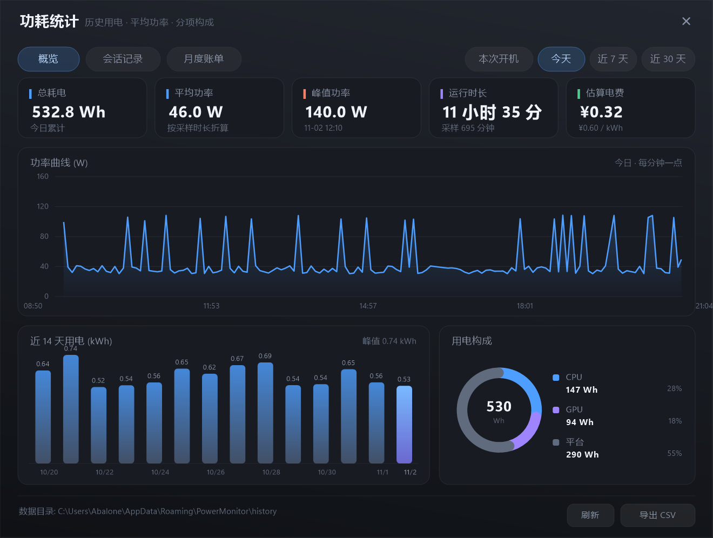
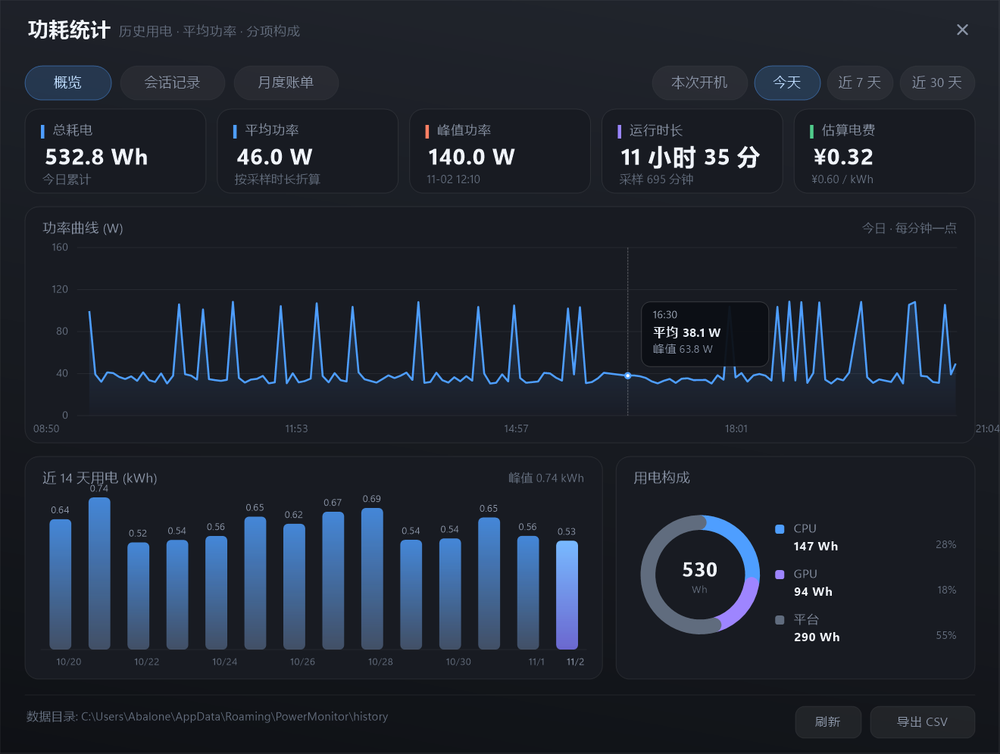
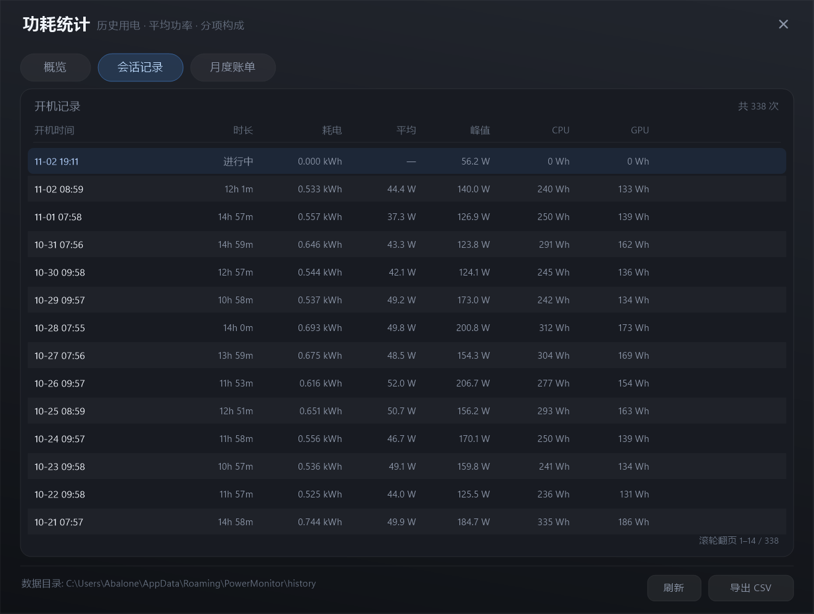
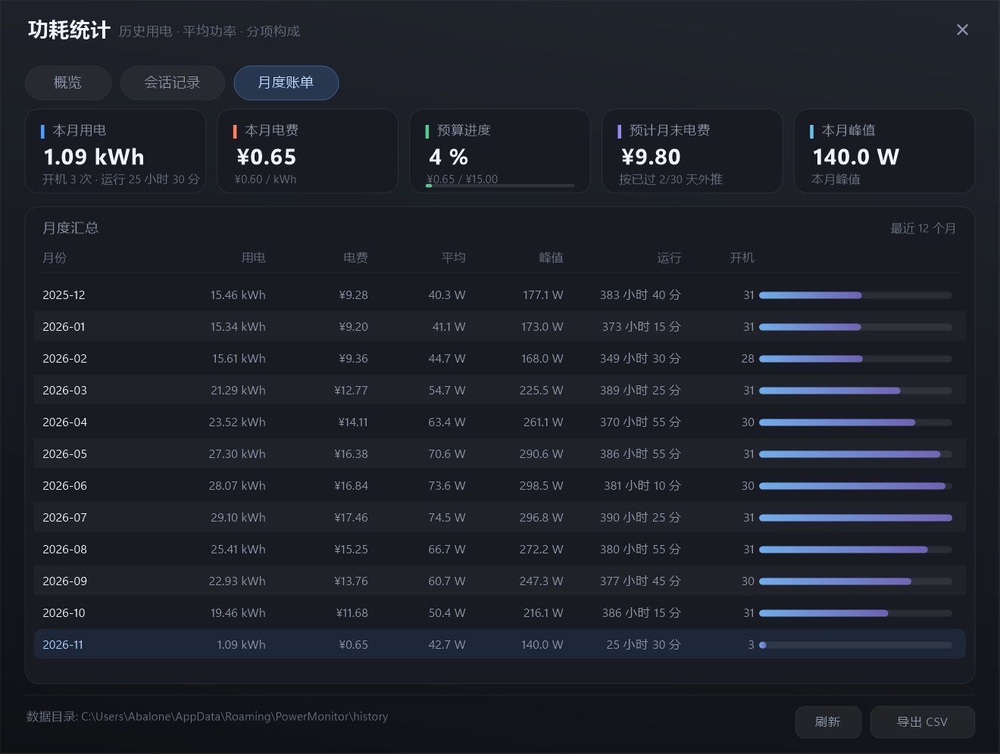
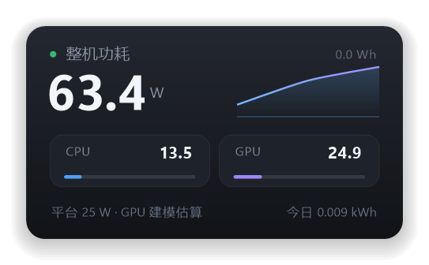

<div align="center">

# PCPowerMonitor

**Windows 任务栏功耗监视器 —— 实时看整机功率，长期记用电账**

托盘里一个会变色的数字 · CPU 功率是真实传感器读数 · 每次开机自动记账

[](#兼容性)
[](#自行编译)
[](#)
[](../../releases)
[](#功能)
[](LICENSE)

[功能](#功能) · [截图](#截图) · [快速开始](#快速开始) · [数据来源](#数据来源与精度说清楚) · [配置](#配置) · [更新日志](#更新日志) · [FAQ](#faq)

</div>

---

## 这是什么

一个 455 KB 的单文件 Windows 托盘小工具，用系统自带的 .NET Framework 运行，**不装任何运行时、不需要管理员权限**。

- **实时**：托盘图标就是当前整机功率数字，按负载变色（绿 → 黄 → 红）；左键弹出实时浮层
- **记账**：每分钟落盘一次功率，按开机批次记录总耗电、平均/峰值功率、CPU/GPU 分项
- **可查**：右键「功耗统计…」打开仪表盘，曲线、柱状图、构成环图、每次开机的会话表、**月度账单**，支持导出 CSV
- **管预算**：设置每月电费预算，用到 80 % / 100 % 时托盘弹出提醒，并给出按当月进度推算的月末账单
- **省电**：常驻 0.05 % 单核、空闲工作集约 6 MB；开机自启，无 UAC 弹窗

> 适用于台式机与笔记本。台式机没有电池读数，所以「整机功率」= CPU 实测 + GPU 估算 + 平台经验值，详见[数据来源](#数据来源与精度说清楚)。

## 功能

### 托盘

| 交互 | 效果 |
| --- | --- |
| 托盘图标 | 实时功率数字（24 px，跟随 DPI），颜色阈值 90 W / 190 W |
| 悬停 | 整机 / CPU / GPU / 今日累计 kWh |
| 左键单击 | 实时浮层：大字功率 + 60 秒曲线 + CPU/GPU 分项卡 + 今日用电 |
| **双击** | 打开统计仪表盘 |
| 右键 | 显示内容（总/CPU/GPU）· 采样间隔（0.5/1/2/5 s）· 开机自启 · 固定托盘图标 · 重新检测传感器 · 退出 |

### 统计仪表盘

- 5 张概览卡：总耗电、平均功率、峰值功率（含发生时刻）、运行时长、估算电费
- 功率曲线：分钟级平均，鼠标悬停出十字线 + 时间/平均值/峰值；数据不足时自动缩放横轴
- 近 14 天用电柱状图（kWh）
- 用电构成环图：CPU / GPU / 平台 的 Wh 与占比
- 时间范围：**本次开机 / 今天 / 近 7 天 / 近 30 天**，超过 340 点自动降采样
- 会话记录表：每次开机一行，当前这次显示「进行中」，滚轮翻页
- **月度账单**：本月用电/电费/预算进度/月末预测/峰值五张卡 + 近 12 个月明细（带电费、平均/峰值功率、运行时长、开机次数与相对条形）
- 一键导出 CSV、点击数据目录直达文件夹

## 截图

**统计仪表盘**



**悬停查看某分钟明细**



**每次开机的用电档案**



**月度账单与电费预算**



**左键弹出的实时浮层**



> 截图中的 14 天数据为演示数据，用于展示图表布局；实际数据保存在你自己的 `%APPDATA%` 下。

## 快速开始

### 方式一：直接用

1. 下载 [Releases 里的 `PCPowerMonitor-1.1.0.zip`](../../releases)（含 exe + 说明），或直接取仓库里的 [`build/PowerMonitor.exe`](build/PowerMonitor.exe)
2. 双击运行，托盘出现数字图标即成
3. 首次启动会**自动写入开机自启**（`HKCU\Software\Microsoft\Windows\CurrentVersion\Run`），可在右键菜单里关掉

> 程序没有代码签名，SmartScreen 可能提示「未知发布者」；介意可自行编译（一条命令，见下文）。

### 方式二：自己编译

需要 Windows 自带的 .NET Framework 4.x（Win10/11 默认就有），**不需要装 Visual Studio 或 .NET SDK**：

```powershell
git clone https://github.com/gybaoyu/PCPowerMonitor.git
cd PCPowerMonitor
powershell -ExecutionPolicy Bypass -File .\build.ps1
# 产物：build\PowerMonitor.exe
```

脚本会调用 `C:\Windows\Microsoft.NET\Framework64\v4.0.30319\csc.exe`，并自动生成多尺寸图标（`tools/make-icon.ps1`）。

## 数据来源与精度（说清楚）

| 指标 | 来源 | 性质 | 说明 |
| --- | --- | --- | --- |
| **CPU** | 性能计数器 `\Energy Meter(RAPL_Package0_PKG)\Power` | ✅ **实测** | Intel RAPL 硬件传感器，单位 mW，普通权限可读，无需驱动 |
| **GPU** | NVML 读取利用率 / 显存 / 频率 → 功率模型 | ⚠️ **估算** | 见下方说明 |
| **平台** | 主板 + 内存 + 硬盘 + 风扇 + VRM | ⚠️ 经验值 | 默认 25 W，可校准 |
| **整机** | CPU + GPU + 平台 | ⚠️ 估算 | 台式机无插座级测量手段 |

**关于 GPU：** 开发机这块 RTX 4060 的 VBIOS 没有向驱动暴露功率传感器 —— `nvidia-smi -q -d POWER` 三项全是 `N/A`，NVML `nvmlDeviceGetPowerUsage` 返回 `NOT_SUPPORTED`。因此 GPU 功率按「利用率 → 功耗」模型换算（空载 8 W、满载 115 W，可配置）。

如果你的显卡支持功率读数，把 `src/PowerMonitor.cs` 里 `GpuReader.Read()` 的模型替换成：

```csharp
nvmlDeviceGetPowerUsage(dev, out uint mw);   // 直接拿真实值
```

**关于毛刺：** RAPL 计数器偶尔会给出不可能的读数（实测见过把 65 W 的 i5-12400F 读成 342 W）。程序做了两层过滤：超过 `CpuMaxW`（默认 200 W）、或相对上一点突变 2.5 倍以上的样本直接丢弃。

**校准到自己的机器：** 拿个功率插座测空载整机功率，把 `PlatformW` 调成 `实测 − CPU − GPU` 即可，满载通常也能保持线性。

## 历史记录怎么算

- 每分钟一个数据桶：平均/最大/最小功率、CPU/GPU/平台分项、**按采样间隔积分出的电量**、实际覆盖时长
- 电量按 `P × Δt` 逐样本累加，不是「平均功率 × 分钟数」，所以中途重启、改采样间隔、短时缺采样都不会算错
- `Δt > 30 s` 视为休眠/待机，不计入电量
- 每次开机一条会话记录（以系统启动时间为 id），保留最近 400 次；分钟桶保留 60 天
- 数据每分钟落盘，崩溃最多丢 1 分钟

## 配置

`%APPDATA%\PowerMonitor\settings.ini`（改完重启程序；每次启动会自动补齐缺失的键）

```ini
IntervalMs=1000    # 采样间隔 250-10000 ms
TrayMetric=0       # 托盘显示 0=总功耗 1=CPU 2=GPU
PlatformW=25.0     # 平台固定开销（主板+内存+硬盘+风扇+VRM）
GpuTgpW=115.0      # 显卡满载功耗上限
GpuIdleW=8.0       # 显卡空载基线
PricePerKwh=0.60   # 电费单价（元/kWh），用于估算电费
CpuMaxW=200        # CPU 功率可信上限，超出视为毛刺
RetentionDays=60   # 历史保留天数（7-730），想看年报表就调大
MonthlyBudgetYuan=0  # 每月电费预算（元），0 = 关闭超支提醒
```

预算提醒：本月电费达到预算的 80 % 与 100 % 时各弹一次气泡（同一档位每月只提醒一次，状态记在 `BudgetAlertState`）。

## 数据文件

`%APPDATA%\PowerMonitor\history\`

**`power-minutes.csv`** —— 每分钟一行，15 列：

```
时间, Σ功率, 样本数, 最大W, 最小W, ΣCPU, nCPU, ΣGPU, nGPU, Σ平台, 电量Wh, CPU电量Wh, GPU电量Wh, 平台电量Wh, 覆盖分钟
```

**`sessions.csv`** —— 每次开机一行，11 列：

```
id, 开机时间, 首次采样, 末次采样, 电量Wh, CPUWh, GPUWh, 平台Wh, 峰值W, 峰值时刻, 采样数
```

两份文件都按 `RetentionDays`（默认 60 天）自动裁剪；统计窗口的「导出 CSV」会生成可读版明细（平均/最大/最小/样本数/分项平均）。

## 命令行

```text
PowerMonitor.exe                          正常启动（托盘常驻）
PowerMonitor.exe --stats                  启动并直接打开统计窗口
PowerMonitor.exe --snapshot out.png       导出实时浮层渲染图（调试用）
PowerMonitor.exe --snapshot-stats out.png 导出统计窗口渲染图（调试用）
```

## 目录结构

```text
build.ps1              编译脚本（系统自带 csc.exe，无需 SDK）
src/PowerMonitor.cs    托盘、采样、浮层、菜单、设置、DPI
src/StatsForm.cs       统计窗口（仪表盘 + 会话表 + 自绘图表）
src/History.cs         历史存储（分钟桶 / 会话 / CSV 读写）
src/app.manifest       PerMonitorV2 DPI 感知 + asInvoker
tools/make-icon.ps1    生成 assets/app.ico（9 种尺寸）
assets/app.ico         程序图标
build/PowerMonitor.exe 预编译产物
shots/*.png            README 截图（含月度账单）
```

## 兼容性

| 项目 | 要求 |
| --- | --- |
| 系统 | Windows 10 / 11（x64 与 ARM64 均可，程序为 AnyCPU） |
| 运行时 | .NET Framework 4.5+（Win10/11 自带 4.8） |
| 权限 | 普通用户即可，不需要管理员 |
| 显卡 | 任意；NVIDIA 走 NVML 估算，其他品牌显示 `--` |

> 系统需要存在 `Energy Meter` 性能计数器对象。Intel / AMD 近十年的平台都有；极老平台可能没有，此时 CPU 功率显示 `--`，整机仅剩 GPU + 平台估算。

## FAQ

**托盘图标找不到？**
Win11 会把新图标先塞进 `^` 折叠区。程序启动后会自动尝试把它固定到任务栏（写 `NotifyIconSettings\IsPromoted`，部分版本要等下次登录生效）。也可以点 `^` 直接把图标拖到任务栏，或到 **设置 → 个性化 → 任务栏 → 其他系统托盘图标** 打开。

**CPU 一直显示 `--`？**
说明系统没有 `Energy Meter` 性能计数器对象。可在 `perfmon` 里搜 `Energy Meter` 确认。

**GPU 读数和实际差多少？**
RTX 4060 这类不暴露功率传感器的卡，误差在「同利用率下 ±20 %」量级；高负载时模型接近 TGP，低负载时略高估。想更准见[上面](#数据来源与精度说清楚)替换成真实 NVML 读数。

**峰值偶尔很离谱？**
已做毛刺过滤。若仍出现异常，把 `CpuMaxW` 调低到你 CPU 的 PL2 上限附近即可。

**会不会很吃资源？**
0.05 % 单核、空闲工作集约 6 MB、单文件 447 KB。每 90 秒会把工作集压回磁盘，任务管理器里不会显示几十 MB。

## Roadmap

- [x] ~~按月汇总与电费预算提醒~~（v1.1.0 已实现）
- [ ] 分钟桶迁移到 SQLite，支持更长历史与更细查询
- [ ] 自定义托盘主题（纯色数字 / 圆角卡片 / 深浅色自适应）
- [ ] 多显卡 / 多路 RAPL 域支持

## 更新日志

### v1.1.0 — 2026-11-02
- 新增 **月度账单** 页：本月用电/电费/预算进度/月末预测/峰值五张卡，以及近 12 个月明细（电费、平均/峰值功率、运行时长、开机次数、相对条形）
- 新增 **电费预算提醒**：本月费用到预算的 80 % 与 100 % 时托盘弹气泡，每个档位每月只提醒一次
- 新增配置项 `MonthlyBudgetYuan`（预算）与 `RetentionDays`（历史保留 7–730 天）
- 修复：统计窗口在 150 % 缩放下尺寸偏小（改用 `GetDpiForWindow` 取每窗口 DPI）
- 修复：RAPL 偶发毛刺会把峰值顶到 300 W 以上（增加 `CpuMaxW` 上限与突变过滤）
- 修复：分钟桶电量按整分钟外推，首尾不完整的分钟会虚高（改为按采样间隔 `P × Δt` 积分）

### v1.0.0 — 2026-11-02
- 首个版本：托盘实时功率、左键浮层、统计仪表盘、会话记录、CSV 导出、开机自启

## English

**PCPowerMonitor** is a tiny Windows tray gadget (447 KB, zero dependencies, .NET Framework only) that shows **real-time whole-system power draw** in the notification area and keeps a **per-boot energy log**.

- CPU power comes from the Intel RAPL perf counter (`\Energy Meter(RAPL_Package0_PKG)\Power`) — a real sensor, readable without admin rights.
- GPU power is modelled from NVML utilisation, because many boards (e.g. this RTX 4060) don't expose a power sensor; the model is configurable.
- Platform overhead (board, RAM, disks, fans, VRM) is a configurable constant, default 25 W.
- Energy is integrated per sample (`P × Δt`), so restarts, sleep and interval changes don't corrupt the totals.

Left-click for the live flyout, double-click for the dashboard (curves, 14-day bars, composition donut, per-boot session table, CSV export). Start with Windows is registered automatically on first run.

Build: `powershell -ExecutionPolicy Bypass -File .\build.ps1` (uses the in-box `csc.exe`, no SDK required).

## License

[MIT](LICENSE) © 2026 gybaoyu
